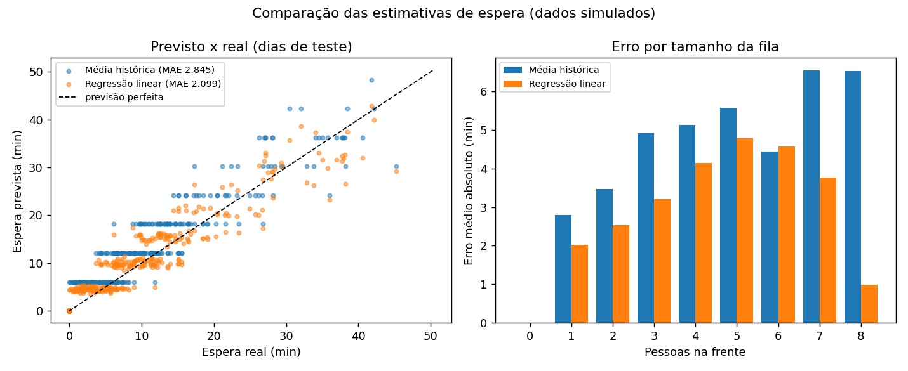

# ThriveQueue — Sistema Inteligente de Gerenciamento de Filas Virtuais

Módulo de fila virtual do **Citizen Assist AI** · **GS 2026.2 · Computer Organization and Architecture · 1CC-FEV**
Rafael Marinucci Peres (RM 569729) · David dos Reis Cardoso (RM 568938)

> Protótipo acadêmico. **Não é canal oficial** de nenhum órgão. As estimativas de espera são aproximadas e o histórico usado para treinar a previsão é **simulado**. Nenhum dado pessoal é coletado: só o tipo do evento, o horário e o tamanho da fila.

Um ESP32 (simulado no Wokwi) com dois botões registra a chegada de cidadãos e a conclusão dos atendimentos, mostra a fila num LCD e envia cada evento por MQTT. Um backend em Python recebe os eventos, estima o tempo de espera de duas formas (média histórica e regressão linear) e publica tudo num dashboard web, além de devolver a previsão para o LCD do ESP32.

```
[Botões] -> ESP32 -> Wi-Fi -> broker MQTT -> backend Python -> navegador
               ^                                   |
               '---------- previsão (MQTT) --------'
```

Planejamento completo: [SPEC.md](SPEC.md)

## Estrutura

```
firmware/esp32_fila_virtual/  código do ESP32 (.ino), circuito (diagram.json), bibliotecas
backend/                      Flask + MQTT + previsão + dashboard (templates/, static/)
simulador/                    gerador do histórico simulado e simulador do ESP32 (plano B)
data/                         histórico simulado e eventos gravados
tests/                        testes automáticos (pytest)
docs/                         diagramas, relatório técnico, evidências, roteiro do vídeo
```

## Como executar

### 1. Backend e dashboard

Requer Python 3.10 ou superior.

```bash
python -m venv .venv
.venv\Scripts\activate          # Windows (no Linux/Mac: source .venv/bin/activate)
pip install -r requirements.txt
python simulador/gerar_historico.py   # cria data/historico_simulado.csv (seed 42)
python -m backend.app
```

Abra http://localhost:5000. Em algumas redes a conexão com o broker leva uns 10 s; o selo "MQTT" fica verde quando conectar.

Para testar só a página, sem rede: `python -m backend.app --sem-mqtt`.

### 2. ESP32 no Wokwi

Siga o passo a passo em [firmware/README.md](firmware/README.md). Com o backend rodando, cada botão apertado no Wokwi aparece no dashboard em poucos segundos.

### 3. Sem o Wokwi (plano B)

```bash
python simulador/simular_esp32.py           # manual: c = chegada, a = atendido, q = sair
python simulador/simular_esp32.py --auto 20 # 20 eventos aleatórios
```

### 4. Testes e avaliação da previsão

```bash
python -m pytest -q
python -m backend.previsao    # gera docs/relatorio/metricas_previsao.csv e comparacao_previsao.png
```

## Previsão do tempo de espera

| Método | Como calcula | MAE | RMSE | R² |
|--------|--------------|----:|-----:|---:|
| Média histórica | pessoas na fila × duração média (6,04 min) | 2,85 min | 4,04 min | 0,83 |
| Regressão linear | pessoas na fila, pessoas × duração dos últimos 5 atendimentos e hora do dia | **2,10 min** | **3,10 min** | **0,90** |

Treino com os dias 1 a 24 e teste com os dias 25 a 30 de um histórico **simulado** de 1.986 atendimentos (um atendente, das 8h às 17h, com o atendimento mais lento no horário de almoço). A regressão erra menos porque percebe quando o atendimento está mais lento e porque a pessoa que já está sendo atendida não ocupa um atendimento inteiro.



## API

| Rota | Retorno |
|------|---------|
| `GET /` | dashboard |
| `GET /api/estado` | fila, concluídos, espera (média e IA), status do ESP32 e do MQTT |
| `GET /api/eventos?n=20` | últimos eventos |
| `GET /api/metricas` | métricas e coeficientes do modelo |

## Links

- Wokwi: https://wokwi.com/projects/480520205989381121
- Relatório técnico: [docs/relatorio/relatorio_tecnico.pdf](docs/relatorio/relatorio_tecnico.pdf)
- Diagramas: [docs/diagramas/](docs/diagramas/)
- Vídeo: TODO
