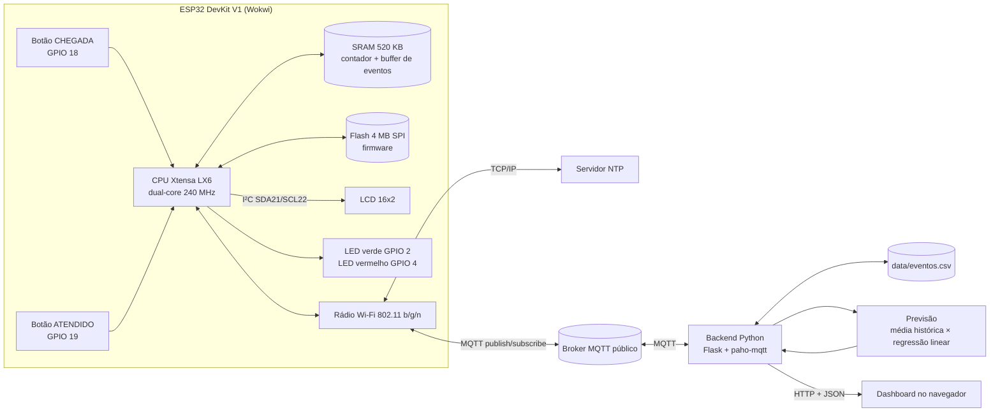
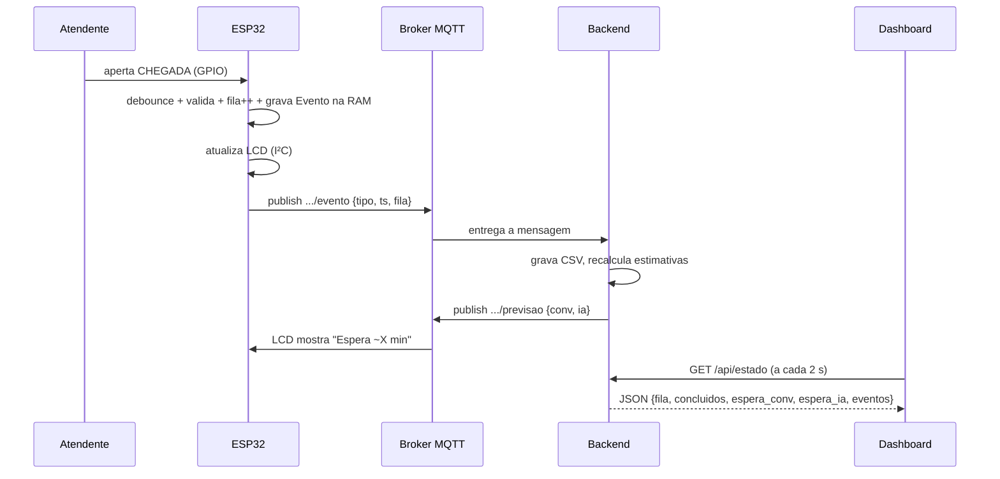
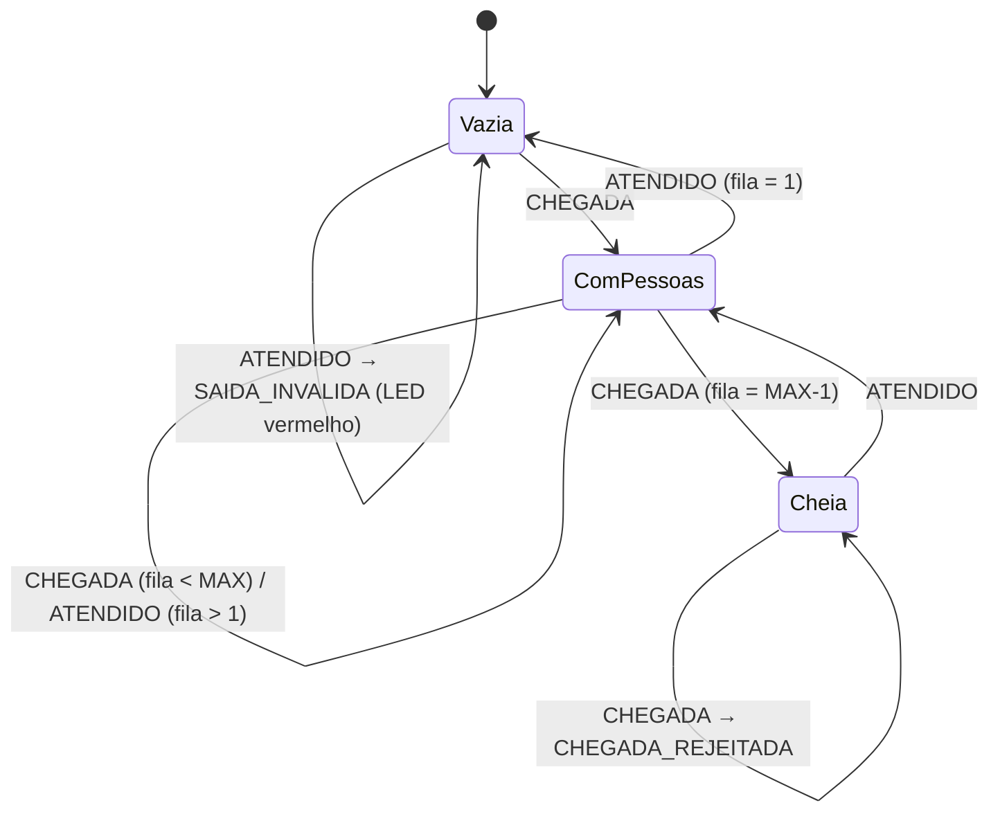

# SPEC — Computer Organization and Architecture | GS 2026.2 · Citizen Assist AI

**Sistema Inteligente de Gerenciamento de Filas Virtuais**

**Integrantes:** Rafael Marinucci Peres (RM: 569729) · David dos Reis Cardoso (RM: 568938)
**Turma:** 1CC-FEV · **Modalidade:** Protótipo + relatório técnico

> **Fontes:** `GS2026_2_Arquitetura_Organizacao_Computadores.pdf` (atividade da disciplina, **prevalece**) · `../GS2026.2 - 1CC - FEV - v1.pdf` (case, calendário e regras do 1CC) · `../Experience FIAP - GS-2sem.pdf` (tema CitizenTech e ODS).
> **Legenda de origem:** **[Enunciado §n]** = obrigatório, vem da seção n do PDF da disciplina · **[GS]** = regra geral do 1CC · **[Sugestão]** = proposta desta spec; a dupla pode trocar · **P-nn** = ponto a confirmar com o professor (seção 15) · **D-nn** = decisão da dupla.
> **Data desta versão:** 12/11/2026 · **Prazo de entrega:** 19/11/2026 [GS] → **faltam 7 dias**. O PDF da disciplina não informa data própria.

---

## 0. TL;DR — o que precisamos fazer

1. **Desenhar a arquitetura** (CPU, RAM/armazenamento, botões, display/dashboard, Wi-Fi/internet) e explicar o fluxo de dados → `docs/diagramas/` + seção no relatório. **(20 pts)**
2. **Construir a fila virtual** num ESP32 simulado no Wokwi: botão CHEGADA, botão ATENDIDO, contador sem valores negativos, display com o total e log de eventos com horário. **(25 pts)**
3. **Prever o tempo de espera** de duas formas, comparando uma **média histórica** com uma **regressão linear**, usando dados simulados e identificados como tal. **(15 pts)**
4. **Publicar os dados pela internet** (ESP32 → MQTT → backend Python → página web) e mostrar fila, tempo estimado e atendimentos concluídos, com atualização automática. **(15 pts)**
5. **Analisar a arquitetura**: processador do ESP32, mapa e uso de memória, E/S, protocolos (GPIO, I²C, Wi-Fi, TCP/IP, MQTT, HTTP) e limitações. **(15 pts)**
6. **Documentar e testar**: README, relatório técnico em PDF, os 4 testes mínimos com evidências e vídeo de até 5 min. **(10 pts)**

### Andamento (atualizado em 12/11)

| Parte | Situação |
|-------|----------|
| Firmware ESP32 + circuito Wokwi | ✅ Pronto. Compila no Wokwi; lógica testada no PC com mocks (T-01..T-08). Falta salvar o projeto e pegar o link público |
| Histórico simulado + previsão | ✅ Pronto. Regressão com MAE 2,10 min contra 2,85 min da média histórica |
| Backend (MQTT + API) e dashboard | ✅ Pronto. Testado ponta a ponta com o simulador via `broker.hivemq.com` |
| Testes automáticos (pytest) | ✅ 13 testes passando |
| Teste com o ESP32 do Wokwi ligado ao backend | ✅ Funcionando (12/11). T-01..T-04 com prints em `docs/evidencias/`. Falta o link público do Wokwi no README |
| Diagramas (sistema, memória, sequência) | ✅ `docs/diagramas/` (SVG + PNG) |
| Relatório técnico | ✅ `docs/relatorio/relatorio_tecnico.pdf` (14 páginas), gerado por `gerar_pdf.py`. Falta a revisão da dupla |
| Firmware v2 (rede no núcleo 0) no projeto Wokwi | ⏳ Colar e salvar no Wokwi |
| Vídeo (até 5 min) | ⏳ Pendente |

---

## 1. Resumo do desafio (enunciado oficial)

**Contexto [Enunciado §1]:** em postos de atendimento, bibliotecas, hospitais e secretarias, a falta de informação sobre filas e tempo de espera atrapalha o cidadão. Como parte do Citizen Assist AI, a equipe deve criar um **protótipo de Sistema Inteligente de Gerenciamento de Filas Virtuais** que una arquitetura e organização de computadores, dispositivos de E/S, processamento, memória e comunicação em rede. O sistema precisa **registrar entradas e saídas, acompanhar o tamanho da fila, estimar o tempo de espera com IA simples e disponibilizar as informações pela internet**.

**Objetivo [Enunciado §2]:** projetar e implementar um sistema computacional funcional que mostre **como hardware e software trabalham juntos** para processar informações e entregá-las ao usuário.

**Plataforma [Enunciado §3, Etapa 2]:** ESP32, Arduino com comunicação adicional, Raspberry Pi, simuladores **ou** uma aplicação que represente a arquitetura proposta.

### Critérios de avaliação [Enunciado §5]

| Critério | Pontos | Onde é atendido nesta spec |
|----------|-------:|----------------------------|
| Arquitetura computacional e diagrama técnico | 20 | Etapa 1 · RF-01 a RF-04 · §8 |
| Funcionamento da fila virtual e entradas/saídas | 25 | Etapa 2 · RF-05 a RF-14 |
| Previsão de espera e aplicação de IA | 15 | Etapa 3 · RF-15 a RF-21 |
| Comunicação em rede e visualização | 15 | Etapa 4 · RF-22 a RF-29 |
| Análise de CPU, memória, interfaces e desempenho | 15 | Etapa 5 · RF-30 a RF-35 |
| Documentação, testes e apresentação | 10 | RF-36 a RF-41 · §10 · §11 |
| **Total** | **100** | |

**Diretriz de avaliação [Enunciado §6]:** a banca valoriza a **coerência entre a arquitetura planejada, a implementação e os resultados apresentados**. Tudo o que aparecer no diagrama deve existir no protótipo, e vice-versa.

---

## 2. Conexão com a GS (CitizenTech, Citizen Assist AI, ODS)

- **CitizenTech [GS]:** o cidadão no centro. O sistema responde a uma dúvida concreta do dia a dia: *"quantas pessoas estão na minha frente e quanto tempo vou esperar?"*. Isso se encaixa nos eixos "cidades mais inteligentes", "dados para decisões reais (sensores, sistemas inteligentes)" e "infraestrutura e conectividade limitadas".
- **Citizen Assist AI [GS]:** a fila virtual é um **módulo de informação em tempo real** do assistente. Em vez de orientar sobre *o que* fazer, ela informa *quando* o atendimento deve acontecer.
- **ODS [Sugestão]:**
  - **ODS 11** (cidades e comunidades sustentáveis): serviços públicos mais eficientes e menos aglomeração.
  - **ODS 10** (redução das desigualdades): idosos, gestantes e pessoas com deficiência deixam de esperar em pé sem informação.
  - **ODS 9** (indústria, inovação e infraestrutura): IoT de baixo custo aplicada a serviço público.
  - **ODS 3** (saúde e bem-estar), se o cenário escolhido for UBS ou hospital (D-01).

---

## 3. Problema, público-alvo e cenário

| Item | Descrição |
|------|-----------|
| **Problema** | O cidadão chega a um posto sem saber quantas pessoas aguardam nem quanto tempo vai esperar, e não consegue planejar o dia [Enunciado §1] |
| **Público-alvo** | Cidadão que usa serviços presenciais (público principal). O atendente ou gestor do posto é o público secundário: aperta os botões e acompanha os indicadores |
| **Cenário (D-01)** | **[Sugestão] Posto de atendimento ao cidadão** (emissão de documentos), genérico e fictício. Alternativa: UBS (puxa o ODS 3) |
| **Hipótese a validar** | "Mostrar o tamanho da fila e uma estimativa de espera pela internet ajuda o cidadão a decidir quando ir ao posto", verificada com o indicador de erro da previsão (MAE) e com um teste rápido de uso do dashboard (§10.3) |

### Decisões da dupla

| ID | Decisão | Opções | Recomendação [Sugestão] |
|----|---------|--------|-------------------------|
| D-01 | Cenário | Posto de documentos · UBS · biblioteca · secretaria | **Posto de atendimento ao cidadão** (fictício, sem marca real) |
| D-02 | Plataforma | ESP32 físico · **ESP32 no Wokwi** · Arduino · Raspberry Pi · só aplicação | **ESP32 DevKit V1 simulado no Wokwi**: é gratuito, não depende de hardware, tem Wi-Fi com internet (`Wokwi-GUEST`) e o processador é bem documentado para a Etapa 5 |
| D-03 | Protocolo ESP32 → nuvem | MQTT · HTTP POST | **MQTT** (publish/subscribe, leve, padrão de IoT) em broker público de teste, como `broker.hivemq.com:1883` |
| D-04 | Backend e IA | Python (Flask + paho-mqtt + scikit-learn/numpy) · Node-RED · ThingSpeak | **Python**: a dupla já usa Python em MLAM e MMC e a regressão linear fica explícita e testável |
| D-05 | Dashboard | Página Flask · Node-RED Dashboard · ThingSpeak | **Página HTML servida pelo Flask**, com JS consultando `/api/estado` a cada 2 s |
| D-06 | Display local | LCD 16x2 I²C · OLED SSD1306 I²C · só Serial | **LCD 16x2 I²C** (mostra o barramento I²C na análise de E/S) |

---

## 4. Escopo

**Dentro do escopo**
- Firmware ESP32 (Arduino C++) com 2 botões, LCD, LEDs de status, validação, log de eventos com horário (NTP) e publicação MQTT.
- Backend Python que recebe eventos, guarda o histórico em CSV, calcula as duas estimativas e serve o dashboard e uma API JSON.
- Gerador de **dados históricos simulados**, marcados como simulados, para treinar e avaliar a regressão.
- Simulador do ESP32 em Python (**modo de contingência**) para demonstrar o backend mesmo se o Wokwi ou o broker ficarem fora do ar.
- Diagramas, relatório técnico, testes e vídeo.

**Fora do escopo**
- Hardware físico obrigatório (o enunciado aceita simuladores).
- Identificação de pessoas, senhas nominais, CPF ou qualquer dado pessoal (LGPD; só contamos eventos).
- Integração com sistemas oficiais de agendamento; o protótipo **não é canal oficial**.
- Autenticação de usuários e hospedagem em produção.

---

## 5. Requisitos funcionais

### Etapa 1 — Arquitetura do sistema (20 pts)
| ID | Requisito | Origem |
|----|-----------|--------|
| RF-01 | Diagrama de arquitetura com **CPU/microcontrolador, RAM, armazenamento, entradas (botões), saídas (LCD/LEDs/dashboard) e interface de internet** | [Enunciado §3 E1] |
| RF-02 | Texto explicando o **fluxo de informação** entre os componentes: botão → GPIO/interrupção → CPU → RAM → LCD e Wi-Fi → broker → backend → navegador | [Enunciado §3 E1] |
| RF-03 | Explicação do **papel do processador, da memória e das interfaces de E/S** | [Enunciado §3 E1] |
| RF-04 | Diagrama em duas visões: (a) **hardware interno do ESP32** (blocos) e (b) **sistema ponta a ponta**. Fonte em Mermaid/draw.io e exportação PNG | [Sugestão] |

### Etapa 2 — Fila virtual (25 pts)
| ID | Requisito | Origem |
|----|-----------|--------|
| RF-05 | **Botão CHEGADA** registra a entrada de uma pessoa (fila += 1) | [Enunciado §3 E2] |
| RF-06 | **Botão ATENDIDO** registra a conclusão de um atendimento (fila −= 1; concluídos += 1) | [Enunciado §3 E2] |
| RF-07 | Atualização **automática** da quantidade de pessoas aguardando no LCD e no dashboard | [Enunciado §3 E2] |
| RF-08 | **Impedir contagem negativa**: ATENDIDO com fila = 0 é rejeitado, acende o LED vermelho, mostra "FILA VAZIA" e registra o evento `SAIDA_INVALIDA` | [Enunciado §3 E2, §6 teste 3] |
| RF-09 | **Impedir operações inválidas**: debounce (≥ 50 ms), os dois botões pressionados ao mesmo tempo são ignorados e a capacidade máxima (ex.: 99) rejeita novas chegadas com o evento `CHEGADA_REJEITADA` | [Enunciado §3 E2] + limites [Sugestão] |
| RF-10 | **Exibir o total** de pessoas na fila (LCD linha 1: `Fila: NN`) | [Enunciado §3 E2] |
| RF-11 | **Registrar eventos e horários** (`timestamp`, `tipo`, `fila_apos`) em buffer circular na RAM, no Serial e enviados via MQTT | [Enunciado §3 E2] |
| RF-12 | Horário real por **NTP** (`configTime`); sem rede, usar `millis()` e marcar `hora_sincronizada=false` | [Sugestão] |
| RF-13 | LED verde pisca a cada operação válida e LED vermelho acende em operação inválida | [Sugestão] |
| RF-14 | Mostrar a estimativa recebida do backend no LCD (linha 2: `Espera: ~MM min`), via assinatura MQTT do tópico `previsao` | [Sugestão], porque reforça a comunicação bidirecional |

### Etapa 3 — Previsão inteligente de espera (15 pts)
| ID | Requisito | Origem |
|----|-----------|--------|
| RF-15 | Estimar a espera considerando o **histórico de atendimentos, o número de pessoas aguardando e o tempo médio de atendimento** | [Enunciado §3 E3] |
| RF-16 | **Estimativa convencional**: `espera = pessoas_na_fila × duração_média_histórica` | [Enunciado §3 E3] |
| RF-17 | **Previsão por IA simples**: **regressão linear**, por exemplo `espera = β0 + β1·pessoas_a_frente + β2·hora_do_dia (+ β3·duração_média_recente)` | [Enunciado §3 E3] |
| RF-18 | **Comparar** as duas estimativas com métricas (**MAE, RMSE, R²**) em dados de teste separados dos de treino, com tabela e gráfico | [Enunciado §3 E3] |
| RF-19 | **Dados simulados identificados**: arquivo `data/historico_simulado.csv` com coluna `origem=SIMULADO`, com o gerador e a seed documentados | [Enunciado §3 E3] |
| RF-20 | Duração real de cada atendimento e espera real de cada pessoa calculadas pelo pareamento **FIFO** entre chegadas e saídas | [Sugestão] |
| RF-21 | A estimativa é **recalculada a cada novo evento** e publicada para o dashboard e o LCD | [Enunciado §6 teste 4] |

### Etapa 4 — Comunicação e visualização (15 pts)
| ID | Requisito | Origem |
|----|-----------|--------|
| RF-22 | Interface **acessível por navegador** | [Enunciado §3 E4] |
| RF-23 | Mostra a **quantidade atual de pessoas na fila** | [Enunciado §3 E4] |
| RF-24 | Mostra o **tempo estimado de espera** (convencional e IA lado a lado) | [Enunciado §3 E4] |
| RF-25 | Mostra a **quantidade de atendimentos concluídos** | [Enunciado §3 E4] |
| RF-26 | **Atualização automática** por comunicação com o sistema (MQTT → backend → `fetch` a cada 2 s) | [Enunciado §3 E4] |
| RF-27 | Mostra a tabela dos últimos eventos com horário e o status da conexão com o ESP32 (último sinal) | [Sugestão] |
| RF-28 | API JSON `GET /api/estado` e `GET /api/eventos` | [Sugestão] |
| RF-29 | Aviso fixo: *"Estimativa aproximada. Protótipo acadêmico, não é canal oficial."* | [GS] |

### Etapa 5 — Análise da arquitetura computacional (15 pts)
| ID | Requisito | Origem |
|----|-----------|--------|
| RF-30 | **Processador**: ESP32 (Xtensa LX6 dual-core, até 240 MHz, 32 bits, arquitetura Harvard modificada, pipeline, FPU, uso dos cores pelo Wi-Fi e pela aplicação) | [Enunciado §3 E5] |
| RF-31 | **Organização da memória**: ROM, SRAM (~520 KB), RTC memory, Flash externa (4 MB, SPI), partições; **estimativa de uso** (relatório de compilação do Wokwi/Arduino com % de Flash e RAM, `ESP.getFreeHeap()`, tamanho da `struct Evento` × capacidade do buffer) | [Enunciado §3 E5] |
| RF-32 | **Operações de entrada, processamento e saída**: GPIO com pull-up, interrupção vs polling, debounce, ciclo do `loop()`, escrita no LCD | [Enunciado §3 E5] |
| RF-33 | **Comunicação e protocolos**: GPIO, I²C (LCD), UART (Serial), Wi-Fi 802.11 b/g/n, TCP/IP, MQTT (QoS, tópicos), NTP, HTTP (navegador ↔ Flask), JSON | [Enunciado §3 E5] |
| RF-34 | **Limitações** de desempenho (latência do broker público, polling de 2 s), memória (tamanho do buffer, fragmentação do heap), conectividade (queda de Wi-Fi, reconexão, perda de mensagens) e o que mudaria em produção | [Enunciado §3 E5] |
| RF-35 | **Medições reais**: latência botão → dashboard (cronometrada), heap livre ao longo do tempo e tempo de execução do `loop()` | [Sugestão] |

### Documentação, testes e apresentação (10 pts)
| ID | Requisito | Origem |
|----|-----------|--------|
| RF-36 | **Repositório organizado e documentado**, com instruções de execução (README) | [Enunciado §4 item 03] |
| RF-37 | **Relatório técnico**: arquitetura, componentes, funcionamento, previsão inteligente, testes e resultados | [Enunciado §4 item 04] |
| RF-38 | **Os 4 testes mínimos** demonstrados e com evidência (print/log): chegada, conclusão, saída com fila vazia, atualização da estimativa | [Enunciado §6] |
| RF-39 | **Vídeo de até 5 min** mostrando o protótipo e suas funcionalidades | [Enunciado §4 item 05] |
| RF-40 | Link público do projeto Wokwi no README | [Sugestão] |
| RF-41 | Testes automatizados da lógica da fila e da previsão (`pytest`) | [Sugestão] |

---

## 6. Requisitos não funcionais

| ID | Requisito | Origem |
|----|-----------|--------|
| RNF-01 | **LGPD**: nenhum dado pessoal; o sistema registra apenas eventos anônimos (tipo + horário + tamanho da fila). Tópicos MQTT em broker público só levam contagens | [GS] |
| RNF-02 | **Não se apresentar como canal oficial**; aviso no dashboard, no README e no vídeo | [GS] |
| RNF-03 | **Avisos de limitação**: a estimativa é aproximada; os dados de treino são simulados | [GS] + [Enunciado §3 E3] |
| RNF-04 | **Acessibilidade básica**: fonte grande nos números principais, contraste AA, `aria-live="polite"` no contador, layout que funciona no celular, sem depender só de cor | [GS] |
| RNF-05 | **Tratamento de entradas inválidas** no firmware (RF-08/09) e no backend (JSON malformado ou evento desconhecido são descartados e logados) | [GS] |
| RNF-06 | **Desempenho**: atualização do dashboard em ≤ 5 s depois do botão, em condições normais de rede | [Sugestão] |
| RNF-07 | **Robustez**: reconexão automática ao Wi-Fi e ao broker; o firmware continua contando offline | [Sugestão] |
| RNF-08 | **Reprodutibilidade**: seed fixa no gerador de dados, `requirements.txt` com versões e instruções passo a passo | [Sugestão] |
| RNF-09 | **Referências**: datasheet do ESP32 e documentação de MQTT, Wokwi e scikit-learn citados no relatório | [GS] |

---

## 7. Conceitos da disciplina a demonstrar

| Conceito | Onde aparece |
|----------|-------------|
| Modelo de von Neumann / Harvard; CPU, memória, E/S, barramentos | Diagrama (RF-01/04) e relatório §Arquitetura |
| Ciclo busca-decodifica-executa; clock; dual-core | Análise do ESP32 (RF-30) |
| Hierarquia de memória (registradores → cache → SRAM → Flash) e volátil vs não volátil | RF-31; o buffer de eventos na SRAM se perde ao reiniciar, e o histórico persistente fica no backend |
| Representação de dados (bits/bytes, `uint8_t`, `uint32_t`, alinhamento de `struct`) | `struct Evento` e cálculo de uso de memória (RF-31) |
| Dispositivos de E/S, GPIO, pull-up, debounce, **interrupção vs polling** | Botões e LEDs (RF-05/09/32) |
| Barramentos seriais: **I²C, UART, SPI** | LCD (I²C), Serial (UART), Flash (SPI) (RF-33) |
| Redes: Wi-Fi, camadas TCP/IP, MQTT, HTTP, NTP | RF-22..29, RF-33 |
| Desempenho e gargalos | RF-34/35 |

---

## 8. Arquitetura proposta [Sugestão]

### 8.1 Visão ponta a ponta



### 8.2 Fluxo de um evento (Teste 1 → Teste 4)



### 8.3 Máquina de estados da fila (firmware)



### 8.4 Estruturas e contratos

**Firmware (`struct Evento`)** — usada no cálculo de memória da Etapa 5:
```c
typedef struct {
  uint32_t timestamp;   // epoch (s), via NTP
  uint8_t  tipo;        // 0=CHEGADA 1=ATENDIDO 2=SAIDA_INVALIDA 3=CHEGADA_REJEITADA
  uint8_t  filaApos;    // tamanho da fila após o evento
} Evento;               // 6 bytes de dados, 8 com alinhamento
Evento buffer[100];     // ~800 B de SRAM (buffer circular)
```

**Tópicos MQTT** (prefixo único para não colidir no broker público):
| Tópico | Direção | Payload (JSON) |
|--------|---------|----------------|
| `fiap1cc/569729-568938/fila/evento` | ESP32 → backend | `{"tipo":"CHEGADA","ts":1763000000,"fila":3,"concluidos":10,"sync":true}` |
| `fiap1cc/569729-568938/fila/status` | ESP32 → backend | `{"online":true,"heap":210000,"rssi":-60}` (a cada 10 s, LWT para offline) |
| `fiap1cc/569729-568938/fila/previsao` | backend → ESP32 | `{"conv_min":12.5,"ia_min":10.8}` |

**API do backend:**
| Rota | Retorno |
|------|---------|
| `GET /` | Dashboard HTML |
| `GET /api/estado` | `{fila, concluidos, espera_convencional_min, espera_ia_min, ultimo_sinal, online}` |
| `GET /api/eventos?n=20` | Últimos N eventos |
| `GET /api/metricas` | MAE/RMSE/R² das duas abordagens |

---

## 9. Dados e base de conhecimento

| Arquivo | Conteúdo | Origem |
|---------|----------|--------|
| `data/historico_simulado.csv` | ~1 000 atendimentos simulados: `id, hora_chegada, pessoas_a_frente, hora_do_dia, duracao_atendimento_min, espera_real_min, origem=SIMULADO` | Gerado por `simulador/gerar_historico.py` (seed 42; chegadas por processo de Poisson com taxa variando por hora; duração ~ normal truncada, média de 6 min) [Sugestão] |
| `data/eventos.csv` | Eventos reais do protótipo: `ts, tipo, fila_apos, origem=WOKWI\|SIMULADOR` | Backend, em tempo real |
| `docs/relatorio/metricas_previsao.csv` | Comparação convencional × IA | `backend/previsao.py` |

**Regra [Enunciado §3 E3]:** todo dado simulado é identificado na coluna `origem`, no README e no relatório.

**Referências a citar (RNF-09):** Espressif, *ESP32 Datasheet* e *ESP32 Technical Reference Manual*; OASIS, *MQTT v3.1.1*; documentação do Wokwi (ESP32, Wi-Fi, LCD I²C); scikit-learn, `LinearRegression`; NXP, *I²C-bus specification*.

---

## 10. Plano de testes

### 10.1 Testes mínimos obrigatórios [Enunciado §6]

| ID | Situação | Passos | Resultado esperado | Evidência |
|----|----------|--------|--------------------|-----------|
| T-01 | **Chegada de novos cidadãos** | Fila 0 → apertar CHEGADA 3× | LCD `Fila: 03`; dashboard 3; 3 eventos `CHEGADA` com horário | Print do Wokwi + dashboard + log Serial |
| T-02 | **Conclusão de atendimentos** | Fila 3 → apertar ATENDIDO 2× | Fila 1; concluídos +2; eventos `ATENDIDO` | Prints + log |
| T-03 | **Saída com fila vazia** | Fila 0 → apertar ATENDIDO | Fila continua 0 (nunca −1); LED vermelho; `FILA VAZIA` no LCD; evento `SAIDA_INVALIDA` | Print + log |
| T-04 | **Atualização da estimativa** | Fila 2 → 5 CHEGADAs → 1 ATENDIDO | Estimativas convencional e IA mudam a cada evento, no dashboard e no LCD | Prints sequenciais + `/api/estado` |

### 10.2 Testes adicionais [Sugestão]

| ID | Teste |
|----|-------|
| T-05 | Debounce: um clique rápido gera um único evento |
| T-06 | Dois botões ao mesmo tempo: nenhum evento |
| T-07 | Capacidade máxima: chegada rejeitada, evento `CHEGADA_REJEITADA` |
| T-08 | Queda de rede (desligar o backend ou o broker): o ESP32 continua contando e o dashboard mostra "offline" |
| T-09 | `pytest`: lógica FIFO, cálculo da média, treino e predição da regressão, JSON inválido |
| T-10 | Latência botão → dashboard, 10 medições (média e máximo) |
| T-11 | Uso de memória: % de Flash/RAM na compilação + `getFreeHeap()` ao longo de 5 min |

### 10.3 Indicadores [GS]
- **Acerto da previsão:** MAE e RMSE (min) da regressão vs média histórica no conjunto de teste. **Meta [Sugestão]:** a IA com MAE menor que a convencional.
- **Tempo para encontrar a informação:** abrir o dashboard e ler fila + espera em < 10 s (teste com 3 a 5 colegas).
- **Facilidade de uso:** nota de 1 a 5 dada pelos mesmos colegas, registrada em `docs/evidencias/teste_usuarios.md`.

---

## 11. Entregáveis e formato de entrega

| # | Entregável [Enunciado §4] | Arquivo/local |
|---|---------------------------|---------------|
| 01 | **Protótipo funcional** | `firmware/` (Wokwi) + `backend/` + link público do Wokwi no README |
| 02 | **Diagrama de arquitetura** | `docs/diagramas/arquitetura_*.png` (+ fontes `.mmd`/`.drawio`) |
| 03 | **Código-fonte** organizado e documentado, com instruções de execução | Repositório GitHub (esta pasta) + `README.md` |
| 04 | **Relatório técnico** (arquitetura, componentes, funcionamento, previsão, testes, resultados) | `docs/relatorio/relatorio_tecnico.pdf` (fonte `.md`) |
| 05 | **Vídeo de até 5 min** | YouTube não listado; link em `docs/video_url.txt` e no README |

**Entrega [GS]:** Portal do Aluno → Entrega de Trabalhos, **até 19/11/2026**. Formato exato (link do GitHub, ZIP ou PDF) a confirmar (P-02).

---

## 12. Critérios de aceite (checklist)

**Etapa 1 — Arquitetura (20)**
- [ ] Diagrama com CPU, RAM, armazenamento, entradas, saídas e internet (RF-01)
- [ ] Texto do fluxo de informações (RF-02) e do papel de CPU, memória e E/S (RF-03)
- [ ] Os componentes do diagrama batem 1:1 com o circuito do Wokwi e o código

**Etapa 2 — Fila (25)**
- [ ] CHEGADA incrementa e ATENDIDO decrementa (RF-05/06)
- [ ] Nunca negativo; operação inválida sinalizada e logada (RF-08/09)
- [ ] LCD e dashboard atualizam sozinhos (RF-07/10)
- [ ] Log de eventos com horário (RF-11/12)

**Etapa 3 — Previsão (15)**
- [ ] Média histórica implementada (RF-16)
- [ ] Regressão linear treinada e usada (RF-17)
- [ ] Tabela e gráfico comparando MAE/RMSE/R² (RF-18)
- [ ] Dados simulados identificados (RF-19)

**Etapa 4 — Rede e visualização (15)**
- [ ] Dashboard no navegador com fila, espera e concluídos (RF-22..25)
- [ ] Atualização automática vinda do ESP32 via MQTT (RF-26)
- [ ] Aviso de "não oficial" (RF-29)

**Etapa 5 — Análise (15)**
- [ ] Processador, memória (com números de uso), E/S, protocolos e limitações (RF-30..34)
- [ ] Ao menos uma medição real (RF-35)

**Documentação (10)**
- [ ] README com passo a passo de execução (RF-36)
- [ ] Relatório técnico em PDF (RF-37)
- [ ] T-01..T-04 com evidências (RF-38)
- [ ] Vídeo ≤ 5 min (RF-39)
- [ ] Nomes e RMs na capa do relatório, no README e no vídeo

---

## 13. Cronograma (12/11 → 19/11) e divisão de tarefas [Sugestão]

| Dia | Rafael (RM 569729) | David (RM 568938) |
|-----|--------------------|-------------------|
| **Qui 12/11** | Fechar D-01..D-06; criar o projeto no Wokwi (ESP32 + 2 botões + LCD + LEDs) | Esboçar o diagrama de arquitetura (RF-01/04) |
| **Sex 13/11** | Firmware: botões, debounce, validação, LCD, buffer de eventos (RF-05..13) | `gerar_historico.py` + `previsao.py` (média + regressão + métricas) |
| **Sáb 14/11** | Firmware: Wi-Fi, NTP, MQTT publish/subscribe (RF-12/14) | Backend Flask + paho-mqtt + CSV + `/api/*` |
| **Dom 15/11** | Integração ponta a ponta Wokwi ↔ broker ↔ backend | Dashboard HTML/JS acessível (RF-22..29) + simulador de contingência |
| **Seg 16/11** | Testes T-01..T-08, prints, medições de latência e memória | `pytest` (T-09) + gráficos da comparação |
| **Ter 17/11** | Relatório: Etapa 5 (análise de CPU, memória, protocolos, limitações) | Relatório: arquitetura, funcionamento, previsão, testes, resultados |
| **Qua 18/11** | Gravar e editar o vídeo (≤ 5 min), roteiro em `docs/roteiro_video.md` | README final, revisão geral, exportar o PDF |
| **Qui 19/11** | **Entrega no portal** (folga até o fim do dia) | Conferir o checklist da §12 |

> Com 7 dias de prazo, **priorizar o caminho crítico**: fila funcionando (25) → diagrama (20) → previsão e dashboard (30) → análise (15). Os itens [Sugestão] (RF-14, RF-35, T-05..T-11, teste com usuários) entram só se sobrar tempo.

---

## 14. Integrações com outras disciplinas

| Disciplina | Tipo | Ligação possível |
|------------|------|------------------|
| Modelagem Linear p/ ML | **Opcional** | Mesma técnica (regressão linear, MAE/R²); reaproveitar o estilo de análise |
| Pensamento Computacional (Python) | **Opcional** | O assistente poderia consultar `/api/estado` para responder "quanto tempo de espera no posto?" |
| Prompt and AI | Não se aplica | — |
| Demais | Não se aplica | — |

Nenhuma integração é exigida pelo PDF da disciplina.

---

## 15. Riscos e pontos a confirmar com o professor

### Riscos
| Risco | Mitigação |
|-------|-----------|
| Broker público instável ou Wokwi lento no dia da gravação | Simulador Python (`simulador/simular_esp32.py`) + broker alternativo (`test.mosquitto.org`) + gravar o vídeo com antecedência |
| Firewall da rede bloqueando a porta 1883 | Testar cedo; alternativa MQTT sobre WebSocket (8000/8884) ou HTTP POST |
| Prazo curto (7 dias) | Cronograma da §13; extras só depois do checklist mínimo |
| Regressão pior que a média | É um resultado válido; explicar o motivo no relatório (o enunciado pede *comparar*, não que a IA vença) |

### Pontos a confirmar
| ID | Pergunta |
|----|----------|
| P-01 | Wokwi (simulação) é aceito como "protótipo funcional" sem hardware físico? (O enunciado cita simuladores; confirmar só por segurança) |
| P-02 | Formato da entrega no portal: link do GitHub, ZIP ou PDF do relatório com links? |
| P-03 | O relatório tem modelo, número de páginas ou norma (ABNT) exigidos? |
| P-04 | O vídeo precisa da participação dos dois integrantes? Onde hospedar? |
| P-05 | Os indicadores de teste com usuários (acerto, tempo, facilidade) do case 1CC são cobrados nesta disciplina? |
| P-06 | A dupla é aceita (o PDF da disciplina menciona "equipes")? |
