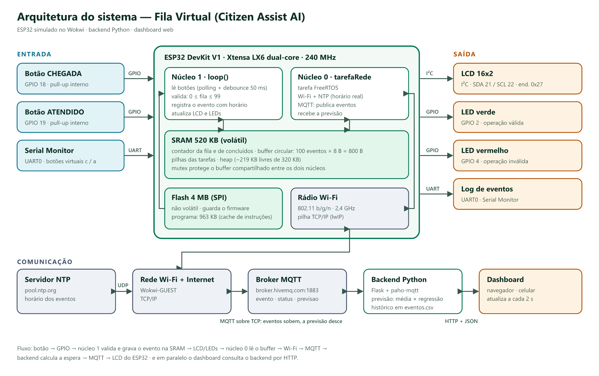
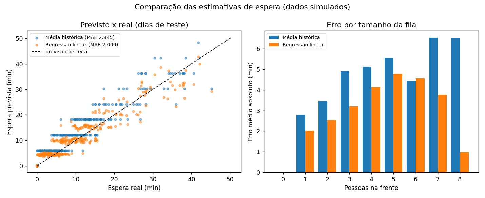
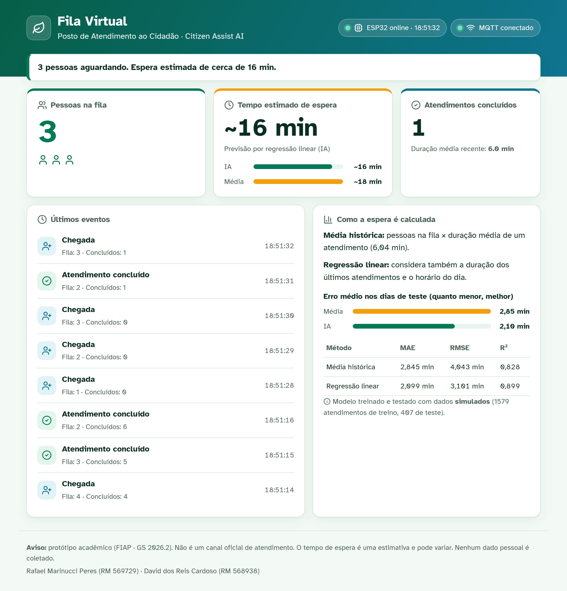
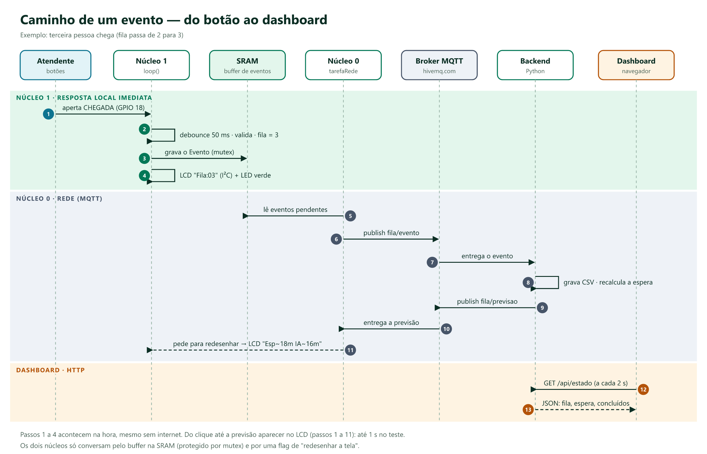
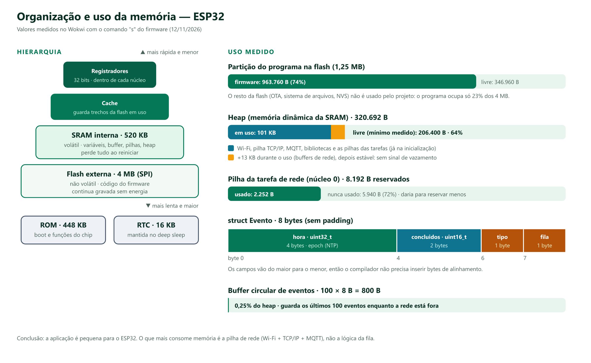
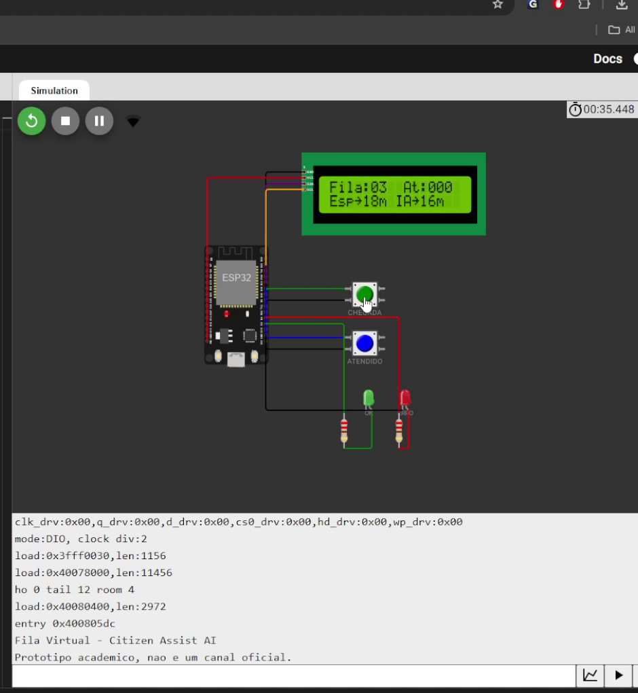
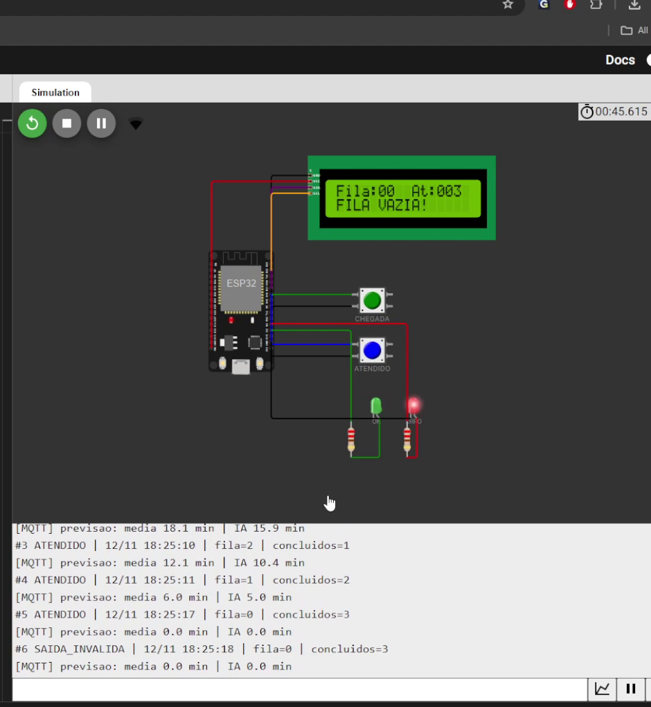
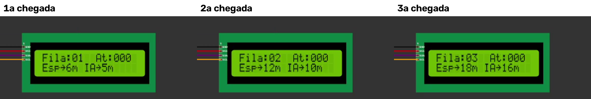

FIAP · Ciência da Computação · Turma 1CC-FEV

Computer Organization and Architecture · Global Solution 2026.2

<h1>Sistema Inteligente de Gerenciamento de Filas Virtuais</h1>

Projeto integrador Citizen Assist AI · Relatório técnico

Rafael Marinucci Peres — RM 569729 David dos Reis Cardoso — RM 568938

Simulação (Wokwi): https://wokwi.com/projects/480520205989381121

São Paulo, novembro de 2026

# 1. Introdução e problema

Em postos de atendimento, unidades de saúde, bibliotecas e secretarias, quem chega não sabe quantas pessoas estão na frente nem quanto tempo vai esperar. Sem essa informação, o cidadão não consegue planejar o dia, e quem tem mais dificuldade de ficar em pé esperando (idosos, gestantes, pessoas com deficiência) é o mais prejudicado.

Este trabalho faz parte do Citizen Assist AI, o assistente digital que a turma está construindo na Global Solution. Aqui a contribuição é um **módulo de informação em tempo real**: uma fila virtual que

- registra a chegada de uma pessoa e a conclusão de um atendimento por meio de botões;
- mantém o total de pessoas aguardando, sem aceitar operações inválidas;
- estima o tempo de espera com uma técnica simples de IA (regressão linear) e a compara com a estimativa tradicional por média;
- publica tudo na internet, num painel que abre no navegador ou no celular.

O cenário escolhido é um **posto de atendimento ao cidadão fictício**. O projeto se relaciona principalmente com o **ODS 11** (cidades e comunidades sustentáveis: serviço público mais eficiente e menos aglomeração), o **ODS 10** (redução das desigualdades: informação acessível para quem tem mais dificuldade de esperar) e o **ODS 9** (inovação e infraestrutura com IoT de baixo custo).

> **Avisos.** O sistema é um protótipo acadêmico e **não é um canal oficial** de nenhum órgão. Nenhum dado pessoal é coletado: o sistema só registra o tipo do evento, o horário e o tamanho da fila (LGPD). O histórico usado para treinar a previsão é **simulado**, e a estimativa de espera é aproximada.

# 2. Arquitetura do sistema (Etapa 1)

O sistema tem três partes:

1. **Dispositivo (ESP32, simulado no Wokwi):** lê os botões, controla a fila, mostra o estado no LCD e nos LEDs e se comunica pela rede.
2. **Backend (Python):** recebe os eventos, guarda o histórico, calcula a previsão de espera e serve o dashboard.
3. **Dashboard (navegador):** mostra a fila, a espera estimada e os atendimentos concluídos para o cidadão.

## 2.1 Componentes exigidos e onde estão

| Componente pedido | No projeto |
|---|---|
| Unidade central de processamento | ESP32 · Xtensa LX6 de 32 bits, **2 núcleos**, 240 MHz |
| Memória RAM | SRAM interna de 520 KB (contador da fila, buffer de eventos, pilhas, heap) |
| Armazenamento | Flash externa de 4 MB via SPI (firmware) · arquivo `eventos.csv` no backend (histórico) |
| Dispositivos de entrada | Botão CHEGADA (GPIO 18), botão ATENDIDO (GPIO 19), Serial Monitor como botões virtuais (UART0) |
| Dispositivos de saída | LCD 16x2 (I²C), LED verde (GPIO 2), LED vermelho (GPIO 4), log no Serial · dashboard web |
| Comunicação com a internet | Rádio Wi-Fi 802.11 b/g/n → TCP/IP → MQTT (broker público) e NTP |

## 2.2 Fluxo de informações

O caminho de um evento está no diagrama da seção 6.3. Resumindo:

1. **Entrada:** o atendente aperta o botão. O pino, que fica em nível alto pelo pull-up interno, vai para nível baixo.
2. **Processamento (núcleo 1):** o `loop()` lê o pino, espera o sinal estabilizar (debounce de 50 ms) e aplica as regras da fila.
3. **Memória:** o evento (horário, tipo, tamanho da fila e concluídos) é gravado num buffer circular na SRAM.
4. **Saída local:** o LCD é atualizado pelo barramento I²C e o LED correspondente acende.
5. **Comunicação (núcleo 0):** uma tarefa separada lê os eventos pendentes do buffer e os publica por MQTT, através do Wi-Fi.
6. **Backend:** recebe o evento, grava o histórico, recalcula a espera e publica a previsão de volta por MQTT.
7. **Saída remota:** o ESP32 mostra a previsão no LCD, e o dashboard consulta o backend por HTTP a cada 2 segundos.

## 2.3 Papel do processador, da memória e das interfaces

- **Processador:** executa o firmware. Aproveitamos os dois núcleos: o **núcleo 1** cuida só da interação local (botões, regras, LCD e LEDs) e o **núcleo 0** cuida da rede. Assim, uma conexão lenta nunca trava os botões (seção 7.5).
- **Memória:** a flash guarda o programa, que continua gravado sem energia. A SRAM guarda o estado em tempo de execução: é rápida, mas volátil. O buffer de eventos fica na SRAM e permite que o ESP32 continue registrando eventos mesmo sem internet. O histórico permanente fica no backend.
- **Interfaces de E/S:** GPIO para os botões e LEDs, I²C para o LCD, UART para o Serial e o rádio Wi-Fi para a rede. Cada interface tem velocidade e protocolo próprios (seção 7.4).

# 3. Componentes de hardware e software

| Hardware (Wokwi) | Função |
|---|---|
| ESP32 DevKit V1 | microcontrolador com Wi-Fi |
| 2 botões (push button) | CHEGADA (verde) e ATENDIDO (azul), ligados ao GND, com pull-up interno |
| LCD 16x2 com módulo I²C (0x27) | mostra `Fila:03  At:012` e a espera estimada |
| 2 LEDs + 2 resistores de 220 Ω | verde: operação válida · vermelho: operação inválida |

| Software | Tecnologia |
|---|---|
| Firmware | C++ (Arduino-ESP32), FreeRTOS, bibliotecas PubSubClient, LiquidCrystal I2C e ArduinoJson |
| Backend | Python 3, Flask (API e página), paho-mqtt, pandas, scikit-learn |
| Dashboard | HTML, CSS e JavaScript puros, com modo claro/escuro e foco em acessibilidade |
| Testes | pytest (backend) e testes do firmware no PC com bibliotecas simuladas |

O código-fonte está organizado no repositório (`firmware/`, `backend/`, `simulador/`, `tests/`, `docs/`), e o README explica como executar cada parte.

# 4. Funcionamento da fila virtual (Etapa 2)

## 4.1 Regras

| Situação | O que acontece | Evento registrado |
|---|---|---|
| CHEGADA com fila < 99 | fila + 1, LED verde pisca | `CHEGADA` |
| CHEGADA com fila = 99 | nada muda, LED vermelho, LCD "FILA CHEIA!" | `CHEGADA_REJEITADA` |
| ATENDIDO com fila > 0 | fila − 1, concluídos + 1, LED verde pisca | `ATENDIDO` |
| ATENDIDO com fila = 0 | **a fila não fica negativa**, LED vermelho, LCD "FILA VAZIA!" | `SAIDA_INVALIDA` |
| Os dois botões ao mesmo tempo | operação ignorada (ambígua), LED vermelho | — |
| Ruído do contato (bounce) | só conta se o sinal ficar estável por 50 ms | — |

## 4.2 Registro de eventos e horários

Cada evento é guardado numa `struct Evento` de 8 bytes (seção 7.2), num **buffer circular de 100 posições**. O horário vem da internet por NTP. Se o NTP ainda não sincronizou, o ESP32 grava "segundos desde o boot" e o backend usa a hora em que recebeu a mensagem.

Os eventos aparecem no Serial (`#3 ATENDIDO | 12/11 18:25:10 | fila=2 | concluidos=1`), são enviados por MQTT e ficam gravados em `data/eventos.csv` no backend. O comando `l` lista os eventos que estão na memória do ESP32.

Se a conexão cair, a fila continua funcionando normalmente. Os eventos ficam no buffer e são enviados em ordem quando a rede volta. Só haveria perda se mais de 100 eventos acontecessem com a rede fora, e esse caso é avisado no Serial.

## 4.3 Sincronização com o backend

O ESP32 é quem manda no contador. Cada mensagem leva o tamanho da fila e o total de concluídos, e o backend sempre se alinha a esses valores. Assim, se o backend reiniciar ou perder uma mensagem, ele se corrige no evento seguinte. O backend também valida cada mensagem: JSON malformado, tipo desconhecido ou fila fora de 0–99 são descartados e contados como inválidos.

# 5. Previsão inteligente de espera (Etapa 3)

## 5.1 Dados

Como não temos dados reais de um posto, geramos um **histórico simulado**, identificado como tal na coluna `origem = SIMULADO`. O gerador é `simulador/gerar_historico.py`, com seed fixa 42, e simula:

- 30 dias de funcionamento, das 8h às 17h, com 1 atendente;
- chegadas aleatórias (processo de Poisson) com taxa variando conforme a hora, de 6 a 9 pessoas por hora;
- duração do atendimento variando conforme o período: em média 5,5 min de manhã, 7,5 min no almoço (12h–14h) e 6 min à tarde, com variação de 30% e mínimo de 1,5 min.

O resultado tem **1.986 atendimentos**, com espera média de 9,1 min e máxima de 50,2 min. Para cada pessoa foram registrados: pessoas na frente, horário, duração média dos últimos 5 atendimentos e a espera real. No sistema funcionando, o backend calcula as mesmas grandezas a partir dos eventos, casando cada chegada com o atendimento correspondente na ordem da fila (FIFO).

## 5.2 As duas estimativas

- **Convencional (média histórica):** `espera = pessoas na fila × duração média de um atendimento` (6,04 min no histórico).
- **IA (regressão linear):** aprende com o histórico usando três variáveis:

  `espera = −1,86 + 3,85·pessoas + 0,264·(pessoas × duração recente) + 0,077·hora do dia`

  O termo `pessoas × duração recente` faz o modelo perceber quando o atendimento está mais lento do que o normal, como no almoço.

## 5.3 Comparação

O modelo foi treinado com os dias 1 a 24 (1.579 atendimentos) e avaliado nos dias 25 a 30 (407 atendimentos), que ele nunca viu.

| Método | MAE (erro médio) | RMSE | R² |
|---|---|---|---|
| Média histórica | 2,85 min | 4,04 min | 0,83 |
| **Regressão linear** | **2,10 min** | **3,10 min** | **0,90** |

A regressão errou **26% menos** em média. Os motivos:

1. A pessoa que já está sendo atendida não ocupa um atendimento inteiro. A média ignora isso, enquanto a regressão aprende um intercepto negativo.
2. A regressão usa a duração dos últimos atendimentos e percebe quando o posto está mais lento.

O gráfico da direita mostra que a vantagem aumenta com o tamanho da fila, que é justamente quando a informação mais importa.

**Limitações:** os dados são simulados, então o resultado mostra que a técnica funciona, mas não prova a precisão num posto real. Com dados reais, o caminho seria retreinar o modelo periodicamente com os eventos gravados em `eventos.csv`.

## 5.4 Atualização da estimativa

A cada evento, o backend recalcula as duas estimativas e publica no tópico `previsao`. O ESP32 mostra no LCD (`Esp~18m IA~16m`) e o dashboard exibe as duas lado a lado. No teste, a previsão nova chegou ao LCD em até 1 segundo depois do clique (seção 8).

# 6. Comunicação e visualização (Etapa 4)

## 6.1 MQTT

Escolhemos MQTT por ser leve e próprio para IoT: o ESP32 só publica e assina tópicos, sem precisar conhecer o endereço do backend. Usamos o broker público `broker.hivemq.com` (porta 1883, TCP).

| Tópico | Sentido | Conteúdo (JSON) |
|---|---|---|
| `fiap1cc/569729-568938/fila/evento` | ESP32 → backend | `{"seq":3,"tipo":"ATENDIDO","ts":1794518710,"sync":true,"fila":2,"concluidos":1,"origem":"WOKWI"}` |
| `fiap1cc/569729-568938/fila/status` | ESP32 → backend (a cada 10 s) | heap, RSSI, tempo do loop… e `{"online":false}` como *last will* se a conexão cair |
| `fiap1cc/569729-568938/fila/previsao` | backend → ESP32 | `{"conv_min":18.1,"ia_min":15.9}` |

## 6.2 Backend e dashboard

O backend em Flask oferece a página e uma API JSON (`/api/estado`, `/api/eventos`, `/api/metricas`). A página consulta `/api/estado` a cada 2 segundos e mostra:

- quantidade atual de pessoas na fila;
- tempo estimado de espera, da IA e da média;
- atendimentos concluídos;
- últimos eventos, com horário;
- situação do ESP32 (online/offline) e do MQTT.

Pensando no público, a página usa uma fonte feita para leitura fácil (Atkinson Hyperlegible), contraste mínimo de 4,5:1 nos modos claro e escuro e ícones sempre acompanhados de texto. Um leitor de tela anuncia uma frase completa, como "3 pessoas aguardando. Espera estimada de cerca de 16 min.". O layout também funciona no celular.

## 6.3 Sequência completa

# 7. Análise da arquitetura computacional (Etapa 5)

## 7.1 Processador

O ESP32 (modelo medido: ESP32-D0WDQ6-V3) tem dois núcleos **Xtensa LX6** de 32 bits a até 240 MHz.

- É um processador **RISC**, com instruções simples executadas em pipeline.
- Segue uma organização **Harvard modificada**: tem barramentos separados para instruções e dados, que acessam regiões diferentes da memória interna.
- A Espressif chama os núcleos de PRO_CPU (núcleo 0) e APP_CPU (núcleo 1). Por padrão, a pilha Wi-Fi roda no núcleo 0 e o `loop()` do Arduino no núcleo 1, confirmado pelo comando `s` (`loop (nucleo 1)`).
- O sistema operacional de tempo real **FreeRTOS** já vem embutido. Usamos dele uma tarefa (`xTaskCreatePinnedToCore`) e um mutex (`xSemaphoreCreateMutex`).

## 7.2 Organização e uso da memória

| Memória | Tamanho | Tipo | O que guardamos |
|---|---|---|---|
| ROM | 448 KB | só leitura | boot e funções internas do chip |
| SRAM | 520 KB | volátil | variáveis, buffer de eventos, pilhas, heap |
| RTC | 16 KB | mantida em deep sleep | não usada |
| Flash (SPI) | 4 MB | não volátil | firmware (963.760 B) |

**Estimativa de utilização (medida no Wokwi):**

- **Programa:** 963.760 B, ou 23% da flash e cerca de 74% da partição de aplicação padrão de 1,25 MB.
- **Heap:** 320.692 B no total. Logo após ligar, sobram 219.660 B; o menor valor medido durante o uso foi 206.400 B (64% livre). O consumo subiu cerca de 13 KB e estabilizou, sem sinal de vazamento de memória.
- **Dados da fila:** `struct Evento` com 8 B (4 do horário, 2 dos concluídos, 1 do tipo e 1 da fila). Os campos estão do maior para o menor, então o compilador não insere padding. O buffer de 100 eventos ocupa 800 B, só 0,25% do heap.
- **Pilha da tarefa de rede:** 8.192 B reservados, dos quais 5.940 B nunca foram usados. Ela usa no máximo cerca de 2,2 KB, então daria para reservar menos.

**Conclusão:** quem mais consome memória é a pilha de rede (Wi-Fi, TCP/IP e MQTT), não a lógica da fila.

## 7.3 Entrada, processamento e saída

- **Entrada por polling:** a cada volta do `loop()` (cerca de 120 µs), o programa lê os dois pinos. O botão só conta depois de 50 ms estável, o que elimina o bounce mecânico (o Wokwi simula esse ruído). Com o `loop()` tão rápido, o polling não perde cliques humanos, que duram mais de 80 ms. Por isso não usamos interrupções, que deixariam o debounce mais complexo.
- **Processamento:** regras simples (comparação e incremento/decremento) e gravação do evento. Leva microssegundos.
- **Saída:** o LCD recebe os dados pelo barramento I²C a 100 kHz, e por isso só é redesenhado quando algo muda. Os LEDs usam GPIO, e os tempos de acender e apagar são controlados com `millis()`, sem `delay()` que travaria o programa.

## 7.4 Comunicação e protocolos

| Ligação | Protocolo | Características |
|---|---|---|
| Botões, LEDs | GPIO digital | nível lógico 0/3,3 V, pull-up interno |
| LCD | I²C | 2 fios (SDA/SCL), endereço 0x27, 100 kHz |
| Serial Monitor | UART | 115200 baud |
| Flash | SPI | memória externa ao núcleo, acessada pelo cache |
| Rede local | Wi-Fi 802.11 b/g/n | 2,4 GHz, rede `Wokwi-GUEST` |
| Internet | TCP/IP (lwIP) | pilha de rede do ESP-IDF |
| ESP32 ↔ backend | MQTT 3.1.1 sobre TCP | publish/subscribe, QoS 0, *keep-alive*, *last will* |
| Horário | NTP sobre UDP | `pool.ntp.org`, fuso UTC−3 |
| Backend ↔ navegador | HTTP + JSON | consulta a cada 2 s |

## 7.5 Desempenho: o problema que encontramos e como resolvemos

Na primeira versão, tudo rodava no `loop()`. Medimos o tempo de cada volta:

| Medida | Versão 1 (tudo no `loop()`) | Versão 2 (rede no núcleo 0) |
|---|---|---|
| `loop()` médio | 145 µs | 119 µs |
| `loop()` máximo | **4.373.871 µs (4,4 s)** | 100.517 µs (0,1 s)\* |
| Ciclo máximo da rede | — | 1.017.856 µs (1,0 s), fora do `loop()` |

\* Os 0,1 s são do próprio comando `s` imprimindo cerca de 600 caracteres a 115200 baud.

Na versão 1, a função `mqtt.connect()` bloqueava o programa enquanto resolvia o DNS e abria a conexão TCP com o broker. Numa reconexão, o `loop()` ficou parado 4,4 s, e um clique nesse intervalo seria perdido.

A solução foi usar o segundo núcleo:

- a rede passou para uma **tarefa FreeRTOS no núcleo 0**;
- o **núcleo 1** ficou só com botões, LCD e LEDs;
- os dois compartilham o buffer de eventos, protegido por um **mutex** para que um núcleo não leia enquanto o outro escreve.

A demora da rede continua existindo, mas não afeta mais a entrada nem o display.

## 7.6 Limitações e melhorias para uso real

| Tipo | Limitação | Melhoria |
|---|---|---|
| Desempenho | Latência depende do broker público (até ~1 s no teste) e o dashboard atualiza a cada 2 s | broker próprio na rede do posto; WebSocket no dashboard |
| Memória | Buffer de 100 eventos na SRAM: se a rede ficar fora por muito tempo, os mais antigos se perdem, e tudo se perde se o ESP32 reiniciar | gravar os pendentes na flash (NVS) |
| Conectividade | Broker público sem autenticação nem criptografia e QoS 0 (sem confirmação de entrega). Observamos reconexões, provavelmente porque outra simulação de teste usava o mesmo *client ID* | TLS (porta 8883), usuário/senha, QoS 1, *client ID* único (já corrigido na versão 2) |
| Escala | Um ESP32 por guichê e um contador único | vários dispositivos publicando em tópicos por guichê |

# 8. Testes e resultados

## 8.1 Testes mínimos do enunciado

Executados no Wokwi com o backend ligado. As imagens foram extraídas do vídeo de teste.

| Teste | Resultado |
|---|---|
| 1. Chegada de novos cidadãos | ✅ 3 chegadas: LCD `Fila:03`, eventos #0–#2 com horário |
| 2. Conclusão de atendimentos | ✅ 2 atendimentos: `Fila:01 At:002` |
| 3. Saída com fila vazia | ✅ fila continua em 0, LED vermelho, "FILA VAZIA!", evento `SAIDA_INVALIDA` |
| 4. Atualização da estimativa | ✅ previsão muda a cada chegada: 6/5 → 12/10 → 18/16 min (média/IA) |

## 8.2 Testes automáticos

- **Backend (pytest, 13 testes):** cobre a lógica da fila, o pareamento FIFO, a rejeição de mensagens inválidas, a detecção de online/offline e a previsão. Um dos testes confere que a IA erra menos que a média nos dias de teste.
- **Firmware:** compilado no PC com versões simuladas das bibliotecas do ESP32, passou nos quatro testes acima. Também passou em casos extras: debounce com ruído, dois botões ao mesmo tempo, fila cheia e envio dos eventos acumulados depois de uma queda de rede.

## 8.3 Medições

As medições de memória e tempo estão nas seções 7.2 e 7.5. A latência do clique até a previsão no LCD ficou em até 1 s.

# 9. Privacidade, limitações e aviso

- **LGPD:** nenhum dado pessoal é coletado ou transmitido. As mensagens só têm contagens e horários.
- **Não é canal oficial:** o aviso aparece no dashboard, no README e no início do Serial.
- **Estimativa aproximada:** a espera é uma previsão, e o modelo foi treinado com dados simulados.

# 10. Conclusão

O protótipo atende às cinco etapas pedidas.

- **Fila:** os botões registram chegadas e atendimentos com horário, a fila nunca fica negativa e as operações inválidas são sinalizadas.
- **Previsão:** a regressão linear superou a média histórica (2,10 contra 2,85 min de erro médio).
- **Comunicação:** os dados chegam ao navegador e voltam ao LCD em cerca de 1 segundo.

Do ponto de vista da disciplina, a lição mais importante veio da medição. O `loop()` travava 4,4 s nas reconexões, e só descobrimos isso medindo o tempo de cada volta. Separar a rede e a interação nos dois núcleos do ESP32, com um mutex protegendo a memória compartilhada, resolveu o problema. Isso mostrou na prática como a organização do processador e da memória afeta o que o usuário percebe.

# Referências

- ESPRESSIF SYSTEMS. *ESP32 Series Datasheet* e *ESP32 Technical Reference Manual*. Disponível em: https://www.espressif.com/en/support/documents/technical-documents.
- ESPRESSIF SYSTEMS. *ESP-IDF Programming Guide: FreeRTOS*. Disponível em: https://docs.espressif.com/projects/esp-idf/.
- OASIS. *MQTT Version 3.1.1*. 2014. Disponível em: https://docs.oasis-open.org/mqtt/mqtt/v3.1.1/mqtt-v3.1.1.html.
- NXP SEMICONDUCTORS. *UM10204: I²C-bus specification and user manual*.
- WOKWI. *Documentação: ESP32 e Wi-Fi*. Disponível em: https://docs.wokwi.com.
- PEDREGOSA, F. et al. Scikit-learn: Machine Learning in Python. *Journal of Machine Learning Research*, v. 12, 2011.
- ONU. *Objetivos de Desenvolvimento Sustentável*. Disponível em: https://brasil.un.org/pt-br/sdgs.
- W3C. *Web Content Accessibility Guidelines (WCAG) 2.2*. 2023.
